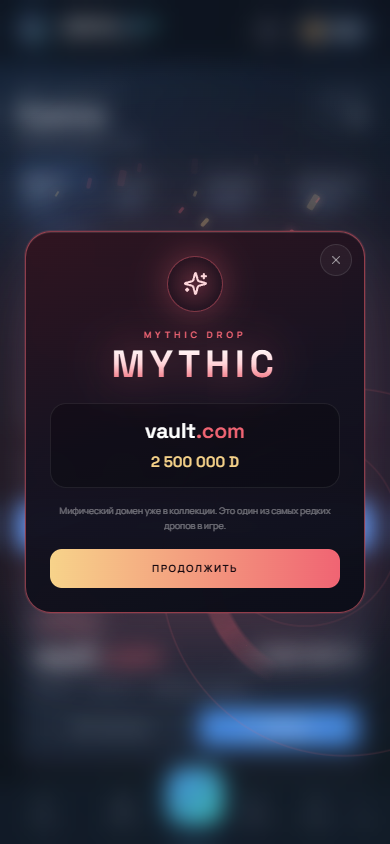
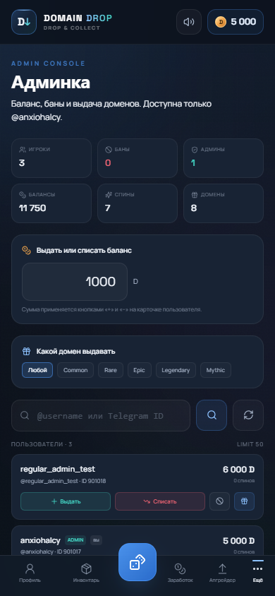
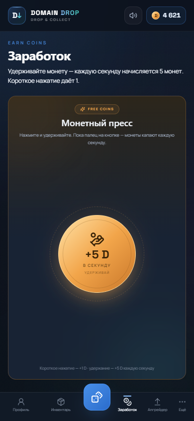
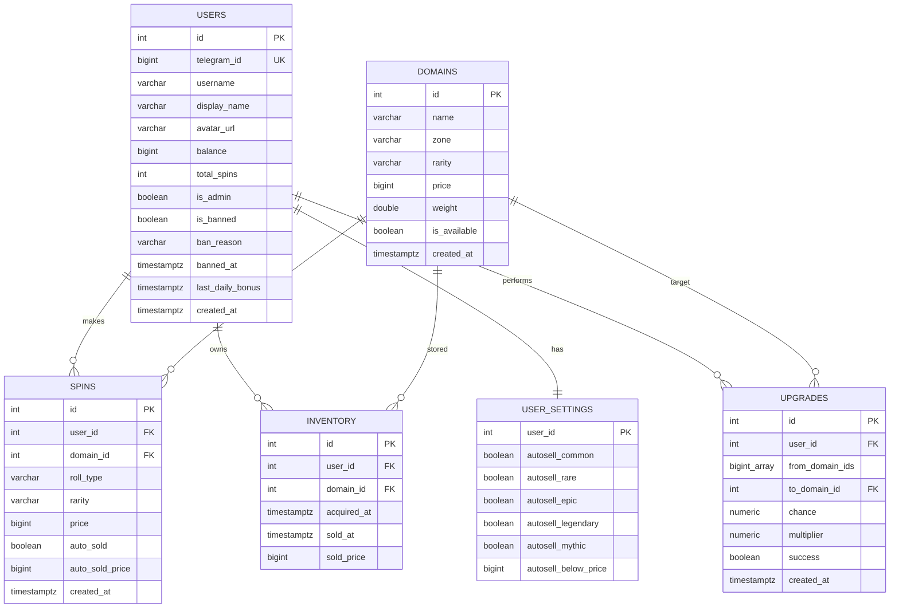

# Domain Drop

**Telegram Mini App — рулетка виртуальных доменов.**  
100 500 уникальных доменов, четыре зоны, индивидуальные цены, четыре рулетки, автопродажа, массовая продажа, визуальный апгрейдер с круговой шкалой шанса и вкладка заработка.

> Все домены вымышленные. Приложение не регистрирует реальные имена, не принимает платежи, не использует реальные деньги и не поддерживает ставки.


## Содержание

- [Быстрый старт](#быстрый-старт)
- [GitHub Codespaces](#github-codespaces)
- [Деплой на Debian 13](#деплой-на-debian-13)
- [Каталог доменов](#каталог-доменов)
- [Рулетки](#рулетки)
- [Экономика и EV](#экономика-и-ev)
- [Автопродажа](#автопродажа)
- [Заработок](#заработок)
- [Админка](#админка)
- [Массовая продажа](#массовая-продажа)
- [Апгрейдер](#апгрейдер)
- [Палитра и интерфейс](#палитра-и-интерфейс)
- [Архитектура](#архитектура)
- [API](#api)
- [База данных](#база-данных)
- [Тесты](#тесты)
- [Переменные окружения](#переменные-окружения)
- [Production checklist](#production-checklist)
- [Источники словарей](#источники-словарей)

---

## Быстрый старт

Нужен Docker Compose v2.

```bash
cd C:\siteharnesstest
docker compose up --build
```

При старте backend пересобирает **100 500 доменов** и обновляет цены/веса в PostgreSQL. На обычном ноутбуке это занимает 10–30 секунд; в это время API ещё не принимает запросы, но старые записи инвентаря сохраняются.

| Что | URL |
|---|---|
| Mini App | http://localhost:3000 |
| API | http://localhost:8000/api |
| Swagger | http://localhost:8000/api/docs |
| Health | http://localhost:8000/api/health |

Для браузера `DEV_MODE=true` включает demo-вход без Telegram. Внутри Telegram вход идёт через подписанный `initData`.

Остановка:

```bash
docker compose down          # сохранить базу
docker compose down -v       # удалить и пересоздать базу
docker compose up -d --build # пересобрать и запустить в фоне
```

### Telegram

1. Создайте бота у [@BotFather](https://t.me/BotFather).
2. Mini App должен открываться по публичному HTTPS.
3. Заполните `.env`:

```dotenv
BOT_TOKEN=123456789:AA...
WEBAPP_URL=https://ваш-публичный-https-адрес
DEV_MODE=false
ENVIRONMENT=production
JWT_SECRET=<случайная-строка>
```

4. Перезапустите:

```bash
docker compose up -d --force-recreate
```

5. Отправьте боту `/start` и нажмите **«Открыть Domain Drop»**.

`WEBAPP_URL` — это адрес **самого Mini App**, а не API. Без HTTPS Telegram не откроет приложение.

---

## GitHub Codespaces

В репозитории есть `.devcontainer/devcontainer.json` с Docker-in-Docker и проброшенными портами.

1. Загрузите проект в приватный GitHub-репозиторий.
2. **Code → Codespaces → Create codespace on main**.
3. В терминале:

```bash
cp .env.example .env
# Codespaces открывает порт через forwarding, поэтому разрешаем bind на 0.0.0.0
sed -i 's/^BIND_HOST=.*/BIND_HOST=0.0.0.0/' .env
docker compose up -d --build
```

4. В панели **Ports** сделайте порт **3000** публичным:

```text
Port Visibility → Public
```

5. Получите адрес вида:

```text
https://ваш-codespace-3000.app.github.dev
```

6. Пропишите его в `.env` как `WEBAPP_URL`, добавьте `BOT_TOKEN`, поставьте `DEV_MODE=false`.
7. Перезапустите:

```bash
docker compose up -d --force-recreate
```

Codespaces подходит для теста, но не для постоянного хостинга: при простое среда останавливается, а удаление Codespace удаляет Docker volumes.

---

## Деплой на Debian 13

Пошаговая инструкция для VPS: установка Docker, `.env`, HTTPS через Caddy или Nginx, Telegram, firewall, бэкапы и **аккуратное удаление старого сайта**:

**[DEPLOY_DEBIAN13.md](DEPLOY_DEBIAN13.md)**

Коротко: на VPS нужны только Docker, Git и reverse-proxy. Python, Node.js, PostgreSQL и Redis работают внутри Docker Compose. Наружу открываются только 22/80/443.

Для чистого Debian 13 с root-доступом есть автоматический скрипт `deploy/bootstrap-root.sh` — см. раздел «Быстрый root-скрипт» в инструкции.

---

## Каталог доменов

При каждом старте создаётся и обновляется **100 500 доменов** в зонах `.ru`, `.com`, `.io`, `.xyz`.

Сидер использует:

- 5 000 английских слов;
- 2 000 русских слов с транслитерацией;
- комбинации «слово + слово»;
- слова с цифрами;
- случайные строки;
- дефисные формы;
- палиндромы и повторы.

Файлы словарей лежат в `backend/app/data/`.

### Формула цены

```text
price = zone × length × readability × pattern × jitter
```

| Фактор | Значение |
|---|---|
| `zone` | `.com` = 100 · `.io` = 30 · `.ru` = 5 · `.xyz` = 0.3 |
| `length` | 2 = 5000 · 3 = 1000 · 4 = 300 · 5 = 100 · 6 = 30 · 7+ = 1 |
| `readability` | словарное слово = 50 · читаемая комбинация = 5 · мусор = 0.1 |
| `pattern` | палиндром = 20 · все символы одинаковые = 15 · дефис+цифры = 0.05 · иначе 1 |
| `jitter` | случайно 0.7…1.3 |

Цена округляется до целых монет и не может быть меньше 1.

Для **Common** финальная цена дополнительно разыгрывается в диапазоне **1–99 D** по детерминированному сиду. Это убирает перекос, когда почти все обычные домены стоили 1 монету. Средняя цена Common — около 50 D, доля цен выше 80 D — около 19%. Формула при этом по-прежнему определяет редкость домена.

Семь референсных доменов закреплены с точными ценами из ТЗ:

| Домен | Цена | Редкость |
|---|---:|---|
| `google.com` | 1 100 000 | Mythic |
| `microsoft.com` | 1 000 000 | Mythic |
| `neo.com` | 250 000 | Mythic |
| `ai.io` | 80 000 | Legendary |
| `vector.ru` | 5 000 | Epic |
| `pixelhub.io` | 1 200 | Epic |
| `lg-shd9uga.xyz` | 10 | Common |

Остальные цены вычисляются генератором и различаются даже внутри одной редкости.

### Редкость

| Цена | Редкость |
|---:|---|
| `< 100` | Common |
| `100–999` | Rare |
| `1 000–9 999` | Epic |
| `10 000–99 999` | Legendary |
| `100 000+` | Mythic |

### Вес в рулетке

```text
weight = luck(rarity) / price^0.6
```

| Редкость | `luck` |
|---|---:|
| Common | 2.5 |
| Rare | 3.2 |
| Epic | 7.0 |
| Legendary | 6.5 |
| Mythic | 5.5 |

Множитель `luck` повышает шанс редких и выше доменов, а степенная кривая оставляет высокие цены редкими внутри своей редкости. Вес хранится в `domains.weight` и пересчитывается миграцией для существующих баз.

Фактические шансы в **Обычной** рулетке после обновления:

| Редкость | Шанс |
|---|---:|
| Common | 81.10% |
| Rare | 17.43% |
| Epic | 1.20% |
| Legendary | 0.24% |
| Mythic | 0.03% |

Итого Rare+ — **18.90%**, Epic+ — **1.47%**. Это уже заметно чаще: примерно каждый пятый обычный спин даёт Rare или выше.

Примерное распределение сгенерированного каталога:

| Редкость | Количество |
|---|---:|
| Common | 54 251 |
| Rare | 35 622 |
| Epic | 4 636 |
| Legendary | 3 577 |
| Mythic | 2 414 |

---

## Рулетки

| Тип | Пул | Стоимость |
|---|---|---:|
| Обычная | все редкости | 100 D |
| Редкая+ | Rare, Epic, Legendary, Mythic | 500 D |
| Эпическая+ | Epic, Legendary, Mythic | 10 000 D |
| Легендарная+ | Legendary, Mythic | 75 000 D |

Сервер фильтрует пул и делает взвешенный выбор по `weight`.

Отдельная «Мифическая» рулетка удалена: при гарантированном Mythic-домене её EV нельзя сбалансировать без изменения цены спина. Mythic-домены остались в пулах «Редкая+», «Эпическая+» и «Легендарная+».

Стоимость списывается сразу при нажатии «Крутить». При выпадении Mythic-домена поверх экрана запускается отдельная анимация: пульсирующие кольца, частицы и крупная плашка с именем и ценой домена. Та же анимация показывается при успешном Mythic-апгрейде.



---

## Экономика и EV

### Одна честная цена

У домена ровно одна цена — `domains.price`. При продаже на баланс зачисляется **вся указанная сумма**, без скрытого курса, комиссии или пересчёта.

Стартовый баланс нового игрока — **5 000 D**, ежедневный бонус — **500 D**.

Чтобы полные выплаты не ломали экономику, переработаны два параметра:

1. **Вес доменов** — `luck / price^0.6` с бонусом для Rare+.
2. **Стоимости рулеток** — заданы вручную: 100 / 500 / 10 000 / 75 000 D.

### EV рулеток

Расчёт по сгенерированному пулу с учётом новых весов:

| Рулетка | Стоимость | EV | RTP | House edge |
|---|---:|---:|---:|---:|
| Обычная | 100 | **302.96** | 303.0% | −203.0% |
| Редкая+ | 500 | **1 463.85** | 292.8% | −192.8% |
| Эпическая+ | 10 000 | **15 505.98** | 155.1% | −55.1% |
| Легендарная+ | 75 000 | **71 664.60** | 95.6% | 4.4% |

Новые цены делают «Обычную», «Редкую+» и «Эпическую+» заметно прибыльными для игрока; «Легендарная+» остаётся с отрицательным EV. Это осознанный баланс под текущие повышенные шансы.

### Апгрейдер

| Сектор | Множитель | EV по цене |
|---:|---:|---:|
| 10% | ×9 | 0.900 |
| 25% | ×3.75 | 0.9375 |
| 50% | ×1.9 | 0.950 |
| 75% | ×1.2 | 0.900 |

Точный шанс генерируется сервером внутри сектора: например, 50% → 50.00…50.99%. Множитель определяется сектором, а не точным процентом. EV каждого сектора меньше 1.

---

## Автопродажа

Экран **Настройки → Автопродажа** (`/settings`).

Правила:

- продавать Common;
- продавать Rare;
- продавать Epic;
- продавать Legendary;
- продавать Mythic;
- продавать всё, если **цена** ниже заданной суммы.

После спина сервер проверяет настройки. Если домен подходит:

1. он не попадает в инвентарь;
2. в ответе спина приходит `auto_sold: true` и `auto_sold_price`;
3. на баланс зачисляется полная цена домена;
4. интерфейс обновляет баланс **только после остановки ленты** — во время прокрута интрига сохраняется;
5. уведомление об автопродаже появляется под шапкой и не перекрывает баланс.

API:

```http
GET /api/settings/autosell
PUT /api/settings/autosell
```

---

## Заработок

Экран **Заработок** (`/earn`) — отдельная вкладка нижнего меню.

- Большая кнопка «Монетный пресс».
- **Удержание** кнопки даёт **+5 D каждую секунду**.
- Короткое нажатие даёт **+1 D**.
- Нет лимитов, кулдаунов и дневного потолка.
- Баланс в шапке растёт сразу, а сервер атомарно увеличивает значение в PostgreSQL.
- На кнопке появляется анимация `+1` / `+5`, работает звук и haptic feedback.
- На странице нет карточек баланса/сеанса и нет кнопки перехода в рулетку.
- Экран статичный: страница не скроллится.

```http
POST /api/earnings/click   # +1 D
POST /api/earnings/hold    # +5 D

Authorization: Bearer <JWT>

→ { "earned": 5, "balance": 5005 }
```

Монеты виртуальные и не имеют реальной стоимости.

---

## Админка

Доступна пользователю **@anxiohalcy** (проверка по Telegram username) и видна в разделе **Ещё**.

Возможности:

- общая статистика: игроки, баны, админы, суммарные балансы, спины, домены;
- поиск по `@username`, имени или Telegram ID;
- выдать или списать баланс любому игроку, включая себя; после операции обновляются строка игрока и баланс в шапке, если изменение было себе;
- забанить или разбанить игрока;
- выдать случайный домен выбранной редкости;
- защита от бана самого себя и других администраторов.

Забаненный пользователь получает `403` на всех защищённых запросах.

```http
GET  /api/admin/overview
GET  /api/admin/users?query=@user
POST /api/admin/users/{id}/balance       { "amount": 1000 }
POST /api/admin/users/{id}/ban           { "banned": true, "reason": "..." }
POST /api/admin/users/{id}/grant-domain  { "rarity": "rare" }
```



---

## Массовая продажа

В инвентаре:

- чекбоксы на карточках;
- «Выбрать все»;
- «Выбрать все Common»;
- «Выбрать до 100 D»;
- «Сбросить»;
- панель «Продать выбранные (N) → +X D»;
- модалка подтверждения.

```http
POST /api/inventory/sell-bulk
{ "ids": [12, 15, 19] }

→ { "sold": 3, "earned": 240, "balance": 1240, "ids": [...] }
```

Все выбранные домены проверяются на владельца и непроданность в одной транзакции.

---

## Апгрейдер

Экран `/upgrader`.

- можно выбрать от 1 до 50 доменов;
- стоимости складываются;
- круговая шкала заполняется на выбранный сектор: 10 / 25 / 50 / 75%;
- процент не округляется до ровного: на шкале может быть `75.21%`, `10.53%` и т.п.;
- цвет шкалы зависит от сектора: синий, фиолетовый, золотой или бирюзовый;
- стрелка облетает шкалу и останавливается на случайном угле;
- если стрелка попала на заполненную часть — апгрейд успешен, если нет — домены сгорают;
- визуальное приземление стрелки соответствует результату;
- множители остались в механике, но их подписи `×9 / ×3.75 / ×1.9 / ×1.2` убраны из интерфейса;
- для 75% целевой множитель — 1.2, для 10% — 9 и так далее;
- сервер выбирает ближайший домен к цене `сумма × множитель`;
- блок **«Может выпасть»** показывает конкретный домен, который сейчас является целью;
- прокрутка идёт прямо на вкладке, без модального окна;
- отдельного подтверждения нет: кнопка «Прокачать» запускает апгрейд сразу;
- если цель дороже максимального Mythic, создаётся новый Mythic-домен;
- при провале **все** выбранные домены сгорают;
- Mythic-домены тоже можно улучшать.

```http
POST /api/upgrade/preview
{ "domain_ids": [4, 8, 15], "chance_sector": 75 }

POST /api/upgrade
{
  "domain_ids": [4, 8, 15],
  "chance_sector": 75,
  "chance": 75.21
}
```

Таблица `upgrades` хранит массив исходных ID, целевой домен, точный шанс, множитель и результат.

---

## Палитра и интерфейс

Тёмная, но более яркая и контрастная тема:

| Роль | Цвет |
|---|---|
| Фон | `#0C121C` |
| Карточки | `#182334` |
| Основной текст | `#F1F5FB` |
| Вторичный текст | `#A1AEC2` |
| Акцент | `#4F9DFF` |
| Бирюзовый | `#43D6C5` |
| Золото | `#F2A54A` |
| Common | `#96A3B8` |
| Rare | `#4D9BFF` |
| Epic | `#B07CFF` |
| Legendary | `#F2A54A` |
| Mythic | `#F06473` |

Апгрейдер получил цветную круговую шкалу шанса, золотые акценты и анимацию стрелки. Без полноэкранных вспышек; скругления 12–16 px и мягкие тени.

### Скриншоты

| Профиль | Инвентарь | Апгрейдер |
|---|---|---|
|  |  |  |

| Заработок | Админка | Лента дропов | Рейтинг |
|---|---|---|---|
|  |  |  |  |

---

## Архитектура

```text
Telegram WebView
      │ initData (HMAC-SHA256)
      ▼
┌───────────────────────────────┐
│ frontend: React + TypeScript  │
│ Vite + Tailwind + framer      │
│ nginx: SPA + /api + WebSocket │
└──────────────┬────────────────┘
               │
               ▼
┌───────────────────────────────┐
│ backend: FastAPI              │
│ auth · spin · inventory       │
│ settings · upgrades · drops   │
│ SQLAlchemy async              │
│  ├─ PostgreSQL                │
│  └─ Redis                     │
│      • rate limit 1 spin / 2s │
│      • Pub/Sub для дропов     │
└──────────────┬────────────────┘
               │
        ┌──────┴────────┐
        ▼               ▼
   aiogram bot      WebSocket clients
```

Сервисы Compose:

- `db` — PostgreSQL 16;
- `redis` — Redis 7;
- `backend` — FastAPI/Uvicorn;
- `bot` — aiogram 3, polling;
- `frontend` — nginx + React build.

Серверный RNG используется внутри API. Seed-хеши и страница проверки удалены из интерфейса и API.

---

## API

База: `/api`. Авторизация: `Authorization: Bearer <JWT>`.

| Метод | Путь | Auth | Назначение |
|---|---|---|---|
| `POST` | `/auth/telegram` | нет | initData / dev-вход, JWT |
| `GET` | `/me` | да | Профиль и статистика |
| `GET` | `/meta` | нет | Типы рулеток, редкости, конфиг экономики |
| `GET` | `/domains` | да | Постраничный каталог |
| `GET` | `/domains/feed` | да | Случайная лента для анимации |
| `POST` | `/spin` | да | Спин `{ "roll_type": "normal" }` |
| `GET` | `/inventory` | да | Непроданные домены |
| `POST` | `/inventory/{id}/sell` | да | Одиночная продажа |
| `POST` | `/inventory/sell-bulk` | да | Массовая продажа |
| `GET` | `/settings/autosell` | да | Настройки автопродажи |
| `PUT` | `/settings/autosell` | да | Сохранить автопродажу |
| `POST` | `/upgrade` | да | Апгрейд доменов |
| `GET` | `/leaderboard` | да | Топ-20 + своя позиция |
| `GET` | `/drops/recent` | да | HTTP-снимок дропов |
| `WS` | `/drops/recent?token=JWT` | JWT | Live-лента |
| `POST` | `/earnings/click` | да | +1 D за короткое нажатие |
| `POST` | `/earnings/hold` | да | +5 D за секунду удержания |
| `GET` | `/admin/overview` | admin | Статистика |
| `GET` | `/admin/users` | admin | Поиск пользователей |
| `POST` | `/admin/users/{id}/balance` | admin | Изменить баланс |
| `POST` | `/admin/users/{id}/ban` | admin | Бан/разбан |
| `POST` | `/admin/users/{id}/grant-domain` | admin | Выдать домен |
| `POST` | `/daily-bonus` | да | +500 D раз в 24 ч |
| `GET` | `/health` | нет | Статус БД/Redis |

### Пример спина

```bash
curl -X POST http://localhost:8000/api/spin \
  -H "Authorization: Bearer $TOKEN" \
  -H 'Content-Type: application/json' \
  -d '{"roll_type":"normal"}'
```

Ответ:

```json
{
  "id": 42,
  "roll_type": "normal",
  "domain": { "full_name": "vector.ru", "price": 5000, "rarity": "epic" },
  "price": 5000,
  "balance": 4950,
  "auto_sold": false,
  "auto_sold_price": null
}
```

Ошибки:

| Код | Когда |
|---|---|
| `401` | Нет/просрочен JWT |
| `402` | Недостаточно монет |
| `409` | Домен уже продан / не принадлежит |
| `422` | Неверный тип рулетки, сектор или пустой список |
| `429` | Rate limit спина или бонус уже получен |
| `503` | Redis/пул недоступны |

---

## База данных



Индексы:

- `domains(name, zone)` — unique;
- `domains(is_available, rarity)`;
- `domains(price)`;
- `inventory(user_id, sold_at)`;
- `spins(user_id, created_at)`;
- `upgrades(user_id, created_at)`.

### Обновление старой базы

В `backend/app/migrations.py` есть идемпотентные `ALTER TABLE` для старого Docker volume: новые поля добавляются, старые 200 доменов убираются из пула, затем создаётся новый каталог. Для чистой установки:

```bash
docker compose down -v
docker compose up --build
```

---

## Тесты

```bash
cd backend
python -m venv .venv
source .venv/bin/activate        # Windows: .venv\Scripts\activate
pip install -r requirements-dev.txt
pytest -q
```

Покрыто:

- 5 000 английских и 2 000 русских словарных строк;
- генерация 100 500 уникальных доменов;
- все четыре зоны;
- формула цены и границы редкостей;
- разброс цен Common и доля доменов дороже 80 D;
- вес `luck / price^0.6` и повышенный шанс Rare+;
- точные референсные цены;
- точные цены четырёх рулеток и EV легендарной;
- удаление Mythic-рулетки из API;
- отрицательный EV секторов апгрейда;
- заработок: +1 D за тап и +5 D за удержание;
- админка: выдача баланса, бан/разбан, выдача домена, запрет бана себя;
- предпросмотр возможного домена в апгрейдере;
- полный API flow: вход → спин → rate limit → автоселл → инвентарь → массовая продажа → апгрейд → рейтинг.

Текущий прогон: **15 passed**.

Frontend:

```bash
cd frontend
pnpm install
pnpm typecheck
pnpm build
```

---

## Переменные окружения

| Переменная | Default | Описание |
|---|---|---|
| `APP_PORT` | `3000` | Порт Mini App |
| `BACKEND_PORT` | `8000` | Порт API |
| `POSTGRES_DB` | `roulette` | БД |
| `POSTGRES_USER` | `roulette` | Пользователь БД |
| `POSTGRES_PASSWORD` | `roulette` | Пароль БД |
| `JWT_SECRET` | dev | Заменить в production |
| `ADMIN_USERNAMES` | `anxiohalcy` | Telegram usernames админов |
| `BOT_TOKEN` | пусто | Токен BotFather |
| `WEBAPP_URL` | localhost | Публичный HTTPS Mini App |
| `DEV_MODE` | `true` | Вход без Telegram |
| `ENVIRONMENT` | `development` | Окружение |
| `CORS_ORIGINS` | localhost | Разрешённые origins |

---

## Production checklist

- [ ] `DEV_MODE=false`
- [ ] Сильный `JWT_SECRET`
- [ ] Публичный HTTPS для `WEBAPP_URL`
- [ ] `BOT_TOKEN` действителен
- [ ] Postgres и Redis не открыты наружу
- [ ] Бэкапы volume `pgdata`
- [ ] Alembic вместо `create_all` при дальнейшем развитии
- [ ] Проверка Mini App на реальном телефоне
- [ ] Codespaces используется только для теста, не как постоянный хостинг

---

## Источники словарей

- English frequency list: [first20hours/google-10000-english](https://github.com/first20hours/google-10000-english)
- Russian frequency list: [hermitdave/FrequencyWords](https://github.com/hermitdave/FrequencyWords)

Из источников отобраны 5 000 английских и 2 000 русских слов. Русские слова транслитерируются в латиницу для доменных имён. В репозитории хранятся уже подготовленные списки `backend/app/data/words_en.txt` и `words_ru.txt`.

---

## Дисклеймер

Domain Drop — демонстрационный виртуальный продукт. Все домены, монеты, дропы и рейтинг существуют только внутри приложения. Реальные регистрации доменов, платежи, ставки и вывод средств отсутствуют.
