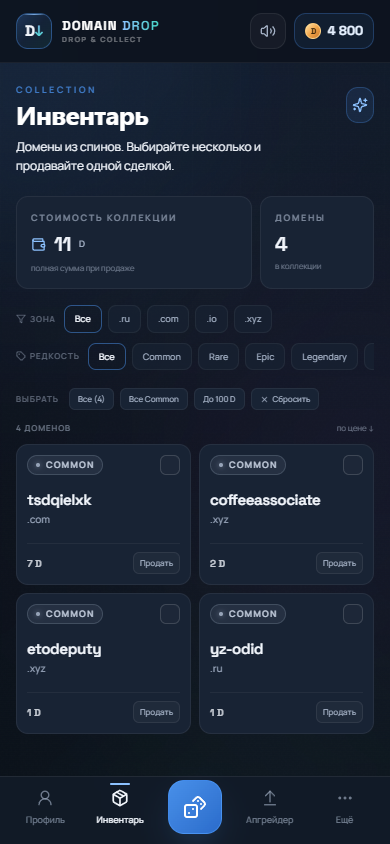
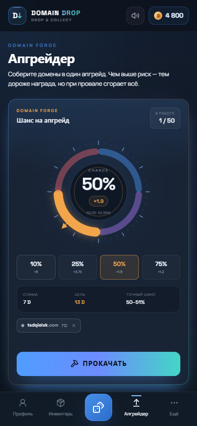
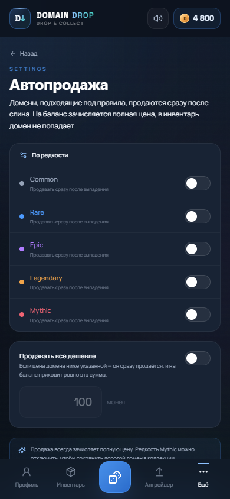
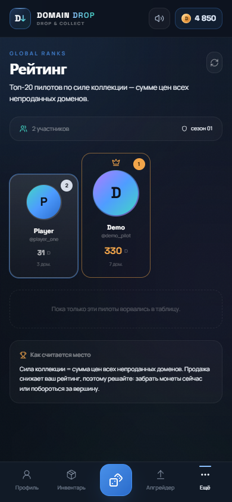
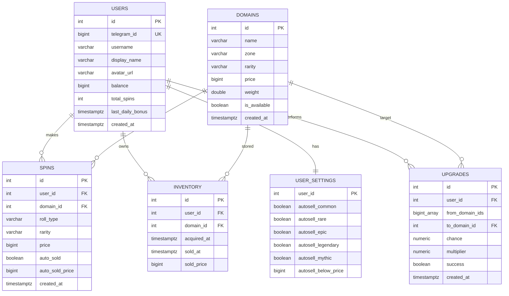

# Domain Drop

**Telegram Mini App — рулетка виртуальных доменов.**  
100 500 уникальных доменов, четыре зоны, индивидуальные цены, четыре рулетки, автопродажа, массовая продажа и визуальный апгрейдер с колесом шанса.

> Все домены вымышленные. Приложение не регистрирует реальные имена, не принимает платежи, не использует реальные деньги и не поддерживает ставки.


## Содержание

- [Быстрый старт](#быстрый-старт)
- [GitHub Codespaces](#github-codespaces)
- [Каталог доменов](#каталог-доменов)
- [Рулетки](#рулетки)
- [Экономика и EV](#экономика-и-ev)
- [Автопродажа](#автопродажа)
- [Массовая продажа](#массовая-продажа)
- [Апгрейдер](#апгрейдер)
- [Палитра и интерфейс](#палитра-и-интерфейс)
- [Архитектура](#архитектура)
- [API](#api)
- [База данных](#база-данных)
- [Тесты](#тесты)
- [Переменные окружения](#переменные-окружения)
- [Production checklist](#production-checklist)
- [Источники словарей](#источники-словарей)

---

## Быстрый старт

Нужен Docker Compose v2.

```bash
cd C:\siteharnesstest
docker compose up --build
```

Первый запуск генерирует и записывает **100 500 доменов** в PostgreSQL. На обычном ноутбуке это занимает 10–30 секунд; backend в это время ещё не принимает запросы.

| Что | URL |
|---|---|
| Mini App | http://localhost:3000 |
| API | http://localhost:8000/api |
| Swagger | http://localhost:8000/api/docs |
| Health | http://localhost:8000/api/health |

Для браузера `DEV_MODE=true` включает demo-вход без Telegram. Внутри Telegram вход идёт через подписанный `initData`.

Остановка:

```bash
docker compose down          # сохранить базу
docker compose down -v       # удалить и пересоздать базу
docker compose up -d --build # пересобрать и запустить в фоне
```

### Telegram

1. Создайте бота у [@BotFather](https://t.me/BotFather).
2. Mini App должен открываться по публичному HTTPS.
3. Заполните `.env`:

```dotenv
BOT_TOKEN=123456789:AA...
WEBAPP_URL=https://ваш-публичный-https-адрес
DEV_MODE=false
ENVIRONMENT=production
JWT_SECRET=<случайная-строка>
```

4. Перезапустите:

```bash
docker compose up -d --force-recreate
```

5. Отправьте боту `/start` и нажмите **«Открыть Domain Drop»**.

`WEBAPP_URL` — это адрес **самого Mini App**, а не API. Без HTTPS Telegram не откроет приложение.

---

## GitHub Codespaces

В репозитории есть `.devcontainer/devcontainer.json` с Docker-in-Docker и проброшенными портами.

1. Загрузите проект в приватный GitHub-репозиторий.
2. **Code → Codespaces → Create codespace on main**.
3. В терминале:

```bash
cp .env.example .env
docker compose up -d --build
```

4. В панели **Ports** сделайте порт **3000** публичным:

```text
Port Visibility → Public
```

5. Получите адрес вида:

```text
https://ваш-codespace-3000.app.github.dev
```

6. Пропишите его в `.env` как `WEBAPP_URL`, добавьте `BOT_TOKEN`, поставьте `DEV_MODE=false`.
7. Перезапустите:

```bash
docker compose up -d --force-recreate
```

Codespaces подходит для теста, но не для постоянного хостинга: при простое среда останавливается, а удаление Codespace удаляет Docker volumes.

---

## Каталог доменов

При первом запуске создаётся **100 500 доменов** в зонах `.ru`, `.com`, `.io`, `.xyz`.

Сидер использует:

- 5 000 английских слов;
- 2 000 русских слов с транслитерацией;
- комбинации «слово + слово»;
- слова с цифрами;
- случайные строки;
- дефисные формы;
- палиндромы и повторы.

Файлы словарей лежат в `backend/app/data/`.

### Формула цены

```text
price = zone × length × readability × pattern × jitter
```

| Фактор | Значение |
|---|---|
| `zone` | `.com` = 100 · `.io` = 30 · `.ru` = 5 · `.xyz` = 0.3 |
| `length` | 2 = 5000 · 3 = 1000 · 4 = 300 · 5 = 100 · 6 = 30 · 7+ = 1 |
| `readability` | словарное слово = 50 · читаемая комбинация = 5 · мусор = 0.1 |
| `pattern` | палиндром = 20 · все символы одинаковые = 15 · дефис+цифры = 0.05 · иначе 1 |
| `jitter` | случайно 0.7…1.3 |

Цена округляется до целых монет и не может быть меньше 1.

Семь референсных доменов закреплены с точными ценами из ТЗ:

| Домен | Цена | Редкость |
|---|---:|---|
| `google.com` | 1 100 000 | Mythic |
| `microsoft.com` | 1 000 000 | Mythic |
| `neo.com` | 250 000 | Mythic |
| `ai.io` | 80 000 | Legendary |
| `vector.ru` | 5 000 | Epic |
| `pixelhub.io` | 1 200 | Epic |
| `lg-shd9uga.xyz` | 10 | Common |

Остальные цены вычисляются генератором и различаются даже внутри одной редкости.

### Редкость

| Цена | Редкость |
|---:|---|
| `< 100` | Common |
| `100–999` | Rare |
| `1 000–9 999` | Epic |
| `10 000–99 999` | Legendary |
| `100 000+` | Mythic |

### Вес в рулетке

```text
weight = 1 / price^0.6
```

Степенная кривая сильно снижает шанс дорогих доменов. Это позволяет сохранить полную цену при продаже и одновременно удержать EV каждой рулетки ниже стоимости спина. Вес хранится в `domains.weight` и пересчитывается миграцией для существующих баз.

Примерное распределение сгенерированного каталога:

| Редкость | Количество |
|---|---:|
| Common | 54 251 |
| Rare | 35 622 |
| Epic | 4 636 |
| Legendary | 3 577 |
| Mythic | 2 414 |

---

## Рулетки

| Тип | Пул | Стоимость |
|---|---|---:|
| Обычная | все редкости | 50 D |
| Необычная+ | Rare, Epic, Legendary, Mythic | 1 100 D |
| Редкая+ | Epic, Legendary, Mythic | 20 000 D |
| Эпическая+ | Legendary, Mythic | 90 000 D |

Сервер фильтрует пул и делает взвешенный выбор по `weight`.

Отдельная «Мифическая» рулетка удалена: при гарантированном Mythic-домене её EV нельзя сбалансировать без изменения цены спина. Mythic-домены остались в пулах «Необычная+», «Редкая+» и «Эпическая+».

---

## Экономика и EV

### Одна честная цена

У домена ровно одна цена — `domains.price`. При продаже на баланс зачисляется **вся указанная сумма**, без скрытого курса, комиссии или пересчёта.

Стартовый баланс нового игрока — **5 000 D**, ежедневный бонус — **500 D**.

Чтобы полные выплаты не ломали экономику, переработаны два параметра:

1. **Вес доменов** — `1 / price^0.6`. Дорогие имена выпадают существенно реже.
2. **Стоимости рулеток** — подняты так, чтобы EV каждой оставался ниже цены спина.

### EV рулеток

Расчёт по сгенерированному пулу с учётом новых весов:

| Рулетка | Стоимость | EV | RTP | House edge |
|---|---:|---:|---:|---:|
| Обычная | 50 | **41.55** | 83.1% | 16.9% |
| Необычная+ | 1 100 | **946.67** | 86.1% | 13.9% |
| Редкая+ | 20 000 | **17 950.11** | 89.8% | 10.2% |
| Эпическая+ | 90 000 | **79 123.05** | 87.9% | 12.1% |

Условие **EV < цены спина** выполнено для всех четырёх типов. Высокие рулетки — инструмент охоты за Legendary/Mythic-доменами, а не быстрый источник монет.

### Апгрейдер

| Сектор | Множитель | EV по цене |
|---:|---:|---:|
| 10% | ×9 | 0.900 |
| 25% | ×3.75 | 0.9375 |
| 50% | ×1.9 | 0.950 |
| 75% | ×1.2 | 0.900 |

Точный шанс генерируется сервером внутри сектора: например, 50% → 50.00…50.99%. Множитель определяется сектором, а не точным процентом. EV каждого сектора меньше 1.

---

## Автопродажа

Экран **Настройки → Автопродажа** (`/settings`).

Правила:

- продавать Common;
- продавать Rare;
- продавать Epic;
- продавать Legendary;
- продавать Mythic;
- продавать всё, если **цена** ниже заданной суммы.

После спина сервер проверяет настройки. Если домен подходит:

1. он не попадает в инвентарь;
2. на баланс зачисляется полная цена домена;
3. в ответе спина приходит `auto_sold: true` и `auto_sold_price`;
4. в UI появляется уведомление об автопродаже.

API:

```http
GET /api/settings/autosell
PUT /api/settings/autosell
```

---

## Массовая продажа

В инвентаре:

- чекбоксы на карточках;
- «Выбрать все»;
- «Выбрать все Common»;
- «Выбрать до 100 D»;
- «Сбросить»;
- панель «Продать выбранные (N) → +X D»;
- модалка подтверждения.

```http
POST /api/inventory/sell-bulk
{ "ids": [12, 15, 19] }

→ { "sold": 3, "earned": 240, "balance": 1240, "ids": [...] }
```

Все выбранные домены проверяются на владельца и непроданность в одной транзакции.

---

## Апгрейдер

Экран `/upgrader`.

- можно выбрать от 1 до 50 доменов;
- стоимости складываются;
- визуальное колесо шанса с секторами 10 / 25 / 50 / 75%;
- при запуске колесо раскручивается, затем показывается результат;
- точный шанс выбирает сервер;
- при успехе создаётся домен с ценой около `сумма × множитель` (±20%);
- целевой домен выбирается из пула подходящей редкости;
- если цель дороже максимального Mythic, создаётся новый Mythic-домен;
- при провале **все** выбранные домены сгорают;
- Mythic-домены тоже можно улучшать.

```http
POST /api/upgrade
{
  "domain_ids": [4, 8, 15],
  "chance_sector": 50
}
```

Таблица `upgrades` хранит массив исходных ID, целевой домен, точный шанс, множитель и результат.

---

## Палитра и интерфейс

Тёмная, но более яркая и контрастная тема:

| Роль | Цвет |
|---|---|
| Фон | `#0C121C` |
| Карточки | `#182334` |
| Основной текст | `#F1F5FB` |
| Вторичный текст | `#A1AEC2` |
| Акцент | `#4F9DFF` |
| Бирюзовый | `#43D6C5` |
| Золото | `#F2A54A` |
| Common | `#96A3B8` |
| Rare | `#4D9BFF` |
| Epic | `#B07CFF` |
| Legendary | `#F2A54A` |
| Mythic | `#F06473` |

Апгрейдер получил цветное колесо шанса, золотые акценты и анимацию прокрутки. Без полноэкранных вспышек; скругления 12–16 px и мягкие тени.

### Скриншоты

| Профиль | Инвентарь | Апгрейдер |
|---|---|---|
|  |  |  |

| Автопродажа | Лента дропов | Рейтинг |
|---|---|---|
|  |  |  |

---

## Архитектура

```text
Telegram WebView
      │ initData (HMAC-SHA256)
      ▼
┌───────────────────────────────┐
│ frontend: React + TypeScript  │
│ Vite + Tailwind + framer      │
│ nginx: SPA + /api + WebSocket │
└──────────────┬────────────────┘
               │
               ▼
┌───────────────────────────────┐
│ backend: FastAPI              │
│ auth · spin · inventory       │
│ settings · upgrades · drops   │
│ SQLAlchemy async              │
│  ├─ PostgreSQL                │
│  └─ Redis                     │
│      • rate limit 1 spin / 2s │
│      • Pub/Sub для дропов     │
└──────────────┬────────────────┘
               │
        ┌──────┴────────┐
        ▼               ▼
   aiogram bot      WebSocket clients
```

Сервисы Compose:

- `db` — PostgreSQL 16;
- `redis` — Redis 7;
- `backend` — FastAPI/Uvicorn;
- `bot` — aiogram 3, polling;
- `frontend` — nginx + React build.

Серверный RNG используется внутри API. Seed-хеши и страница проверки удалены из интерфейса и API.

---

## API

База: `/api`. Авторизация: `Authorization: Bearer <JWT>`.

| Метод | Путь | Auth | Назначение |
|---|---|---|---|
| `POST` | `/auth/telegram` | нет | initData / dev-вход, JWT |
| `GET` | `/me` | да | Профиль и статистика |
| `GET` | `/meta` | нет | Типы рулеток, редкости, конфиг экономики |
| `GET` | `/domains` | да | Постраничный каталог |
| `GET` | `/domains/feed` | да | Случайная лента для анимации |
| `POST` | `/spin` | да | Спин `{ "roll_type": "normal" }` |
| `GET` | `/inventory` | да | Непроданные домены |
| `POST` | `/inventory/{id}/sell` | да | Одиночная продажа |
| `POST` | `/inventory/sell-bulk` | да | Массовая продажа |
| `GET` | `/settings/autosell` | да | Настройки автопродажи |
| `PUT` | `/settings/autosell` | да | Сохранить автопродажу |
| `POST` | `/upgrade` | да | Апгрейд доменов |
| `GET` | `/leaderboard` | да | Топ-20 + своя позиция |
| `GET` | `/drops/recent` | да | HTTP-снимок дропов |
| `WS` | `/drops/recent?token=JWT` | JWT | Live-лента |
| `POST` | `/daily-bonus` | да | +500 D раз в 24 ч |
| `GET` | `/health` | нет | Статус БД/Redis |

### Пример спина

```bash
curl -X POST http://localhost:8000/api/spin \
  -H "Authorization: Bearer $TOKEN" \
  -H 'Content-Type: application/json' \
  -d '{"roll_type":"normal"}'
```

Ответ:

```json
{
  "id": 42,
  "roll_type": "normal",
  "domain": { "full_name": "vector.ru", "price": 5000, "rarity": "epic" },
  "price": 5000,
  "balance": 4950,
  "auto_sold": false,
  "auto_sold_price": null
}
```

Ошибки:

| Код | Когда |
|---|---|
| `401` | Нет/просрочен JWT |
| `402` | Недостаточно монет |
| `409` | Домен уже продан / не принадлежит |
| `422` | Неверный тип рулетки, сектор или пустой список |
| `429` | Rate limit спина или бонус уже получен |
| `503` | Redis/пул недоступны |

---

## База данных



Индексы:

- `domains(name, zone)` — unique;
- `domains(is_available, rarity)`;
- `domains(price)`;
- `inventory(user_id, sold_at)`;
- `spins(user_id, created_at)`;
- `upgrades(user_id, created_at)`.

### Обновление старой базы

В `backend/app/migrations.py` есть идемпотентные `ALTER TABLE` для старого Docker volume: новые поля добавляются, старые 200 доменов убираются из пула, затем создаётся новый каталог. Для чистой установки:

```bash
docker compose down -v
docker compose up --build
```

---

## Тесты

```bash
cd backend
python -m venv .venv
source .venv/bin/activate        # Windows: .venv\Scripts\activate
pip install -r requirements-dev.txt
pytest -q
```

Покрыто:

- 5 000 английских и 2 000 русских словарных строк;
- генерация 100 500 уникальных доменов;
- все четыре зоны;
- формула цены и границы редкостей;
- вес `1 / price^0.6`;
- точные референсные цены;
- EV всех четырёх рулеток < стоимости;
- удаление Mythic-рулетки из API;
- отрицательный EV секторов апгрейда;
- полный API flow: вход → спин → rate limit → автоселл → инвентарь → массовая продажа → апгрейд → рейтинг.

Текущий прогон: **12 passed**.

Frontend:

```bash
cd frontend
pnpm install
pnpm typecheck
pnpm build
```

---

## Переменные окружения

| Переменная | Default | Описание |
|---|---|---|
| `APP_PORT` | `3000` | Порт Mini App |
| `BACKEND_PORT` | `8000` | Порт API |
| `POSTGRES_DB` | `roulette` | БД |
| `POSTGRES_USER` | `roulette` | Пользователь БД |
| `POSTGRES_PASSWORD` | `roulette` | Пароль БД |
| `JWT_SECRET` | dev | Заменить в production |
| `BOT_TOKEN` | пусто | Токен BotFather |
| `WEBAPP_URL` | localhost | Публичный HTTPS Mini App |
| `DEV_MODE` | `true` | Вход без Telegram |
| `ENVIRONMENT` | `development` | Окружение |
| `CORS_ORIGINS` | localhost | Разрешённые origins |

---

## Production checklist

- [ ] `DEV_MODE=false`
- [ ] Сильный `JWT_SECRET`
- [ ] Публичный HTTPS для `WEBAPP_URL`
- [ ] `BOT_TOKEN` действителен
- [ ] Postgres и Redis не открыты наружу
- [ ] Бэкапы volume `pgdata`
- [ ] Alembic вместо `create_all` при дальнейшем развитии
- [ ] Проверка Mini App на реальном телефоне
- [ ] Codespaces используется только для теста, не как постоянный хостинг

---

## Источники словарей

- English frequency list: [first20hours/google-10000-english](https://github.com/first20hours/google-10000-english)
- Russian frequency list: [hermitdave/FrequencyWords](https://github.com/hermitdave/FrequencyWords)

Из источников отобраны 5 000 английских и 2 000 русских слов. Русские слова транслитерируются в латиницу для доменных имён. В репозитории хранятся уже подготовленные списки `backend/app/data/words_en.txt` и `words_ru.txt`.

---

## Дисклеймер

Domain Drop — демонстрационный виртуальный продукт. Все домены, монеты, дропы и рейтинг существуют только внутри приложения. Реальные регистрации доменов, платежи, ставки и вывод средств отсутствуют.
